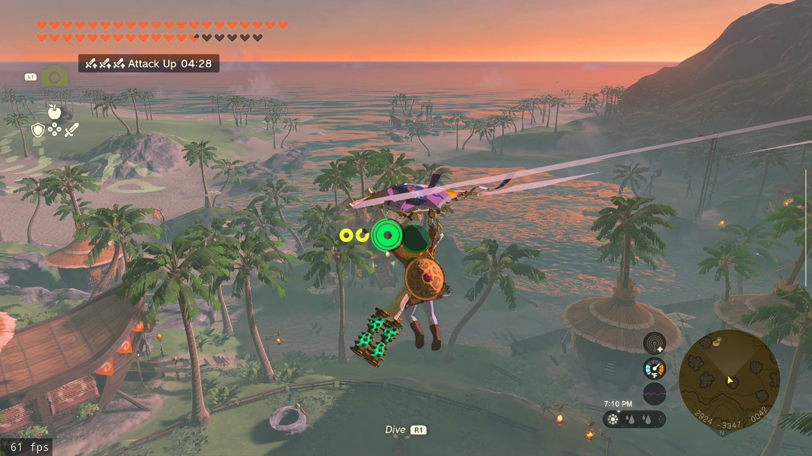
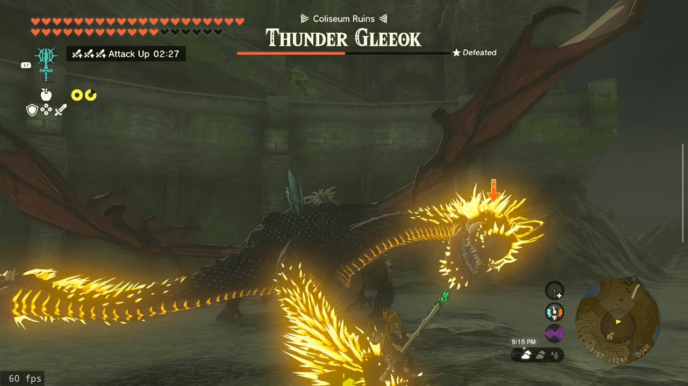
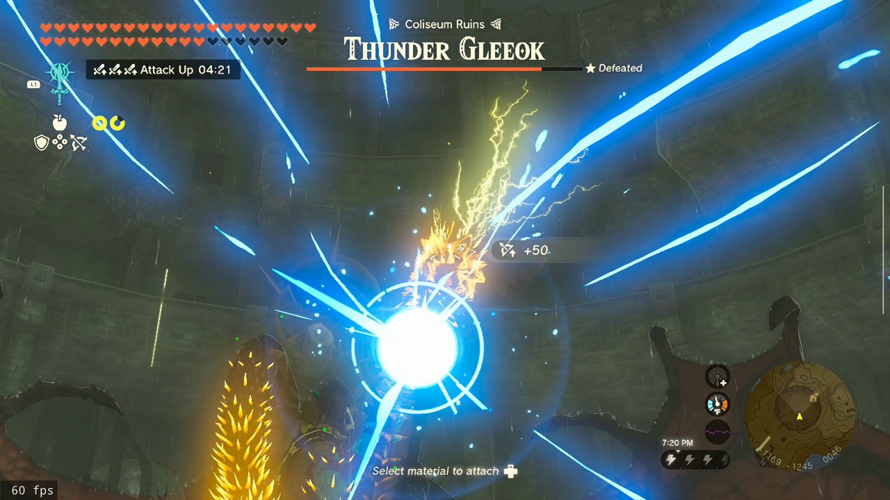
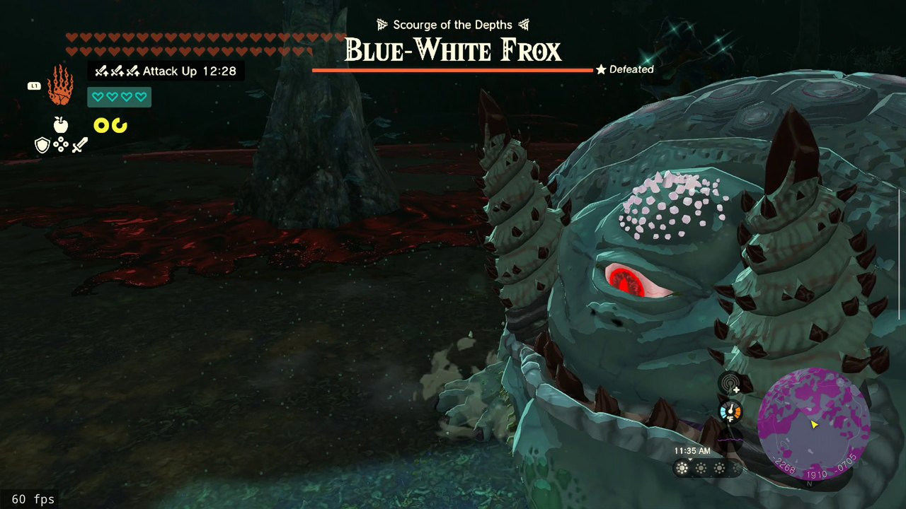
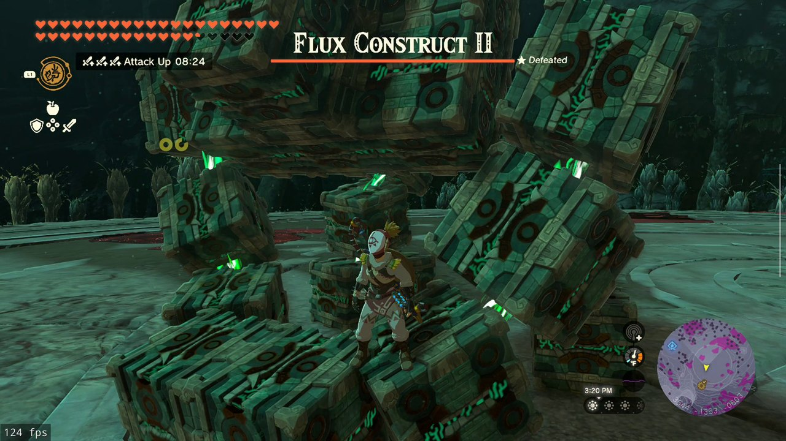
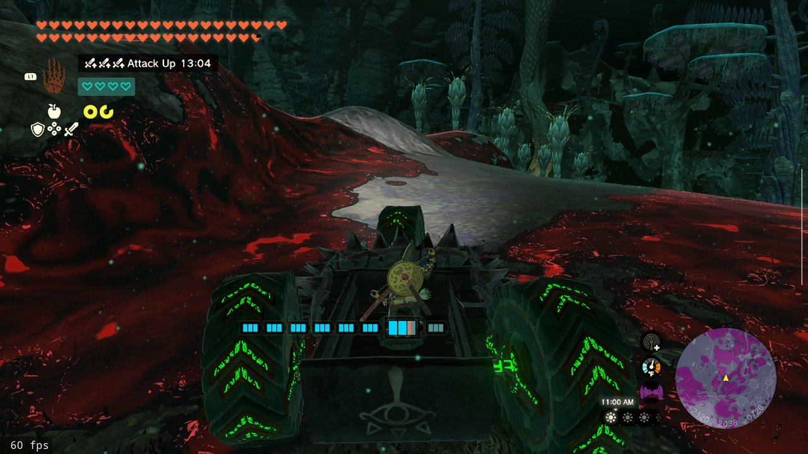
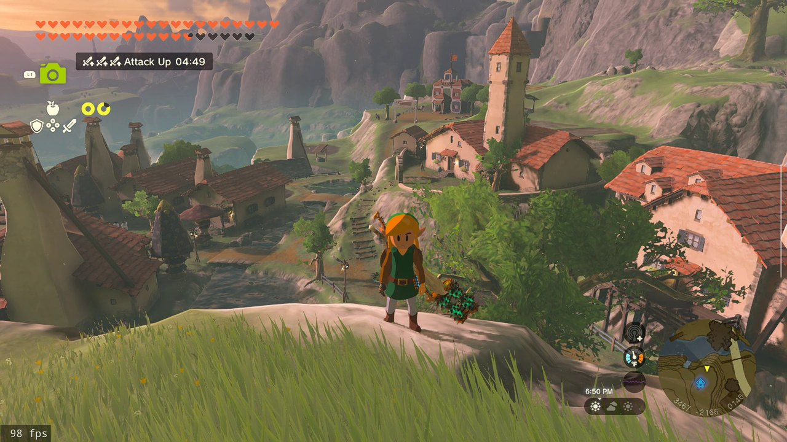
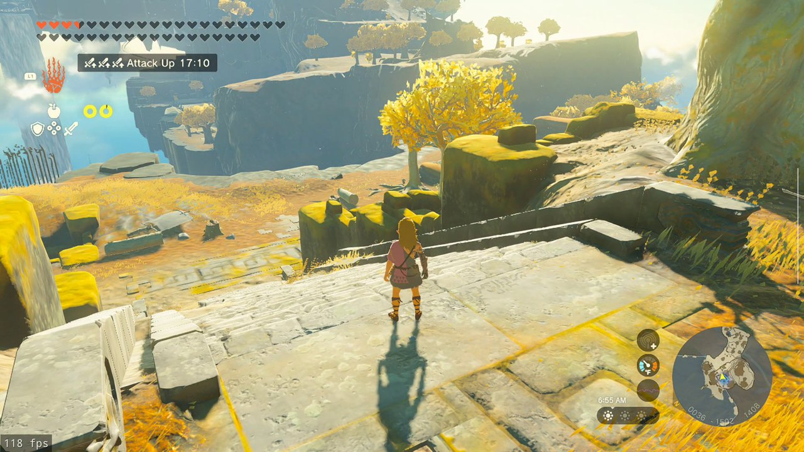
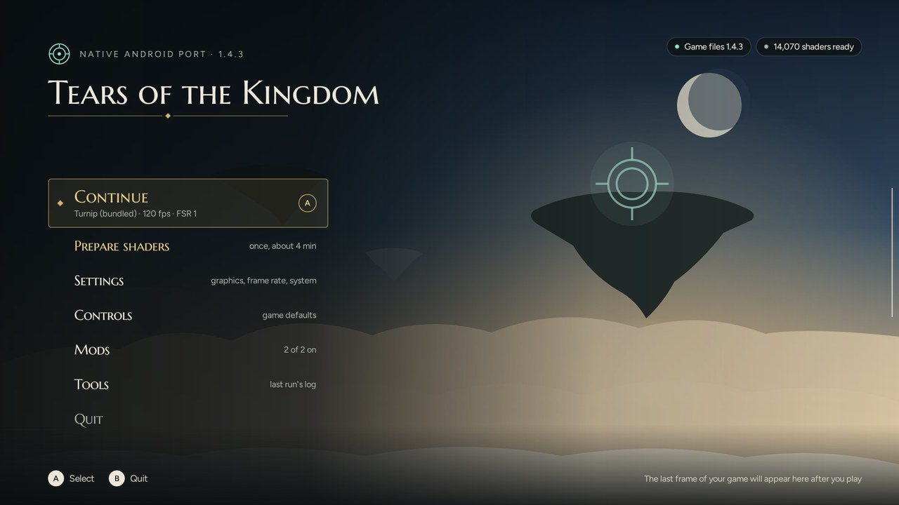

# Freudentränen (Tears of Joy) ToTK Android Native

The Legend of Zelda: Tears of the Kingdom (Nintendo Switch, 1.4.3) running natively on Android: the game's own
ARM64 code executes on the device, with a host for the Switch's system services and NVN graphics. It is not an
emulator, and it needs no PC.

**Bring your own copy.** This repository and the app hold no game content: no game code, data, keys or firmware.

## Install
You will need:
- An Android 13 or newer device with a Snapdragon (Adreno) GPU and a controller, built in or paired. See
  [Status](#status-pre-alpha) for what has been tested.
- Your own copy of the game: the base game, version 1.0.0, as an NSP or XCI file, and the 1.4.3 update as an NSP file.
- Your console's keys, as a `prod.keys` file.
- A few GB of free space for shaders. The game is played from your files where they are, with nothing copied.

Then:
1. Install [Obtainium](https://github.com/ImranR98/Obtainium), then tap the badge above to add this app and get its
   updates. You can also download the APK from [Releases](https://github.com/winterskycode/freudentranen/releases).
2. Open the app. On the Game files page, pick your `prod.keys`, then the folder that holds the game and the update.
3. Press Continue. The first start takes a little longer, and shaders are built as you play. Prepare shaders on the
   startup screen builds them ahead of time (once, in a few minutes), which means fewer hitches early on.

## Features
- **Native:** the game's own code runs on the device, with a Vulkan renderer for its NVN graphics.
- **Frame rate:** limits from 30 to 120 FPS, above the Switch's 30 FPS cap.
- **Frame generation:** built-in, AMD FSR 3.1, or lsfg-vk with your own copy of Lossless Scaling.
- **Image quality:** render resolution up to 2560×1440, FSR 1 upscaling, SMAA, anisotropic filtering, and higher
  resolution shadows. Arm ASR upscaling is experimental.
- **GPU drivers:** the bundled Turnip driver, your device's own, or one installed from a zip.
- **Controls:** remappable field controls, motion aiming, and Xbox, Switch or PlayStation button prompts.
- **Mods:** RomFS mods, installed and managed in the app.
- **Saves:** export and import in the app, as a zip or folder in the game's own format. Your current save is backed
  up first.
- **In-game menu:** change settings while you play, with an optional performance overlay.
- **Bug reports:** one press saves a report with a video of the last 30 seconds.

## Screenshots
| | |
|---|---|
|  |  |
|  |  |
|  |  |
|  |  |

Taken on an AYN Odin 3, some with frame generation on (the FPS counter includes generated frames), and an AYN Thor.

## Status: pre-alpha
Expect bugs and crashes. The game plays from the title screen through the open world on the AYN Odin 3 (Snapdragon 8
Elite, Adreno 830), the device it is developed on. It also runs on the AYN Thor (Adreno 740) and a Sony Xperia 1 VI
(Adreno 750), with less testing. Other devices and GPUs are untested.

Reports and pull requests are welcome; changes are reviewed before they are merged.

## How this was made
This project was built with extensive AI assistance (Claude, through Claude Code): porting, the graphics backend,
debugging on the device and the tools around them. Without it, the project would not exist. We say so up front
because we have nothing to hide, and because you should know how the code you run was written. Changes are tested
on the device, and their commit messages say how each one was found and checked.

## Building
`BUILDING.md` describes building the APK, including the bundled Turnip driver, from source. Releases are built from a
tag (`.github/workflows/release.yml`).

## Layout
- `port/android/`: the Android app: the compatibility layer for MacNativeGames' Apple APIs, the host (window, input,
  audio, bug reports), the Vulkan backend (`vk/`), the startup screen (`app/`) and the build and device tools (`tools/`).
- `port/rewriter/`: the code rewriter with the Android target (jhaizhou's rewriter as MacNativeGames uses it, with the
  D2R Android port's Android target merged in).
- `port/xlate/`: builds of the Ryujinx shader translator (NativeAOT).
- `port/build_all.py`: extract, verify and rewrite the game files on a PC, for development. Players do not need it.
- `patches/`: this project's changes to Turnip. Its changes to MacNativeGames are on the android branch of our fork.
- Device tools in `port/android/tools/`: `saves.py` (import and export saves over adb, with backups; the app does the same on its own under
  Tools > Saves), `bench.py` (a repeatable
  camera-orbit benchmark on a given save), `aot_shaders.py` and `push_shaders.sh` (translate every shader ahead of time;
  optional, as the app translates them on demand).

## Credits and licences
This port stands on other people's work:

- [MacNativeGames](https://github.com/ly05010419/MacNativeGames) (MIT; our changes are in [our fork](https://github.com/winterskycode/MacNativeGames)): the native runtime, the game's patches and the
  rewriter it builds on.
- [d2r-mobile](https://github.com/jhaizhou-ops/d2r-mobile) by jhaizhou (MIT): the code rewriter and the NVN graphics
  layer.
- [d2r-android](https://github.com/sydeEvans/d2r-android) by sydeEvans (MIT): the first Android port of d2r-mobile.
- The D2R Android port by ImL1s (AGPL-3.0; it was published at gitlab.com/aa22396584/d2r-mobile, and neither it nor its
  GitHub mirror is public any more): the Vulkan renderer, the GPU driver loader and the rewriter's Android target all
  started as its code.
- Ryujinx's shader translator and the .NET runtime compiled into it (MIT), the Turnip driver from
  [Mesa](https://mesa3d.org) (MIT, some parts Apache-2.0 / BSL-1.0), libadrenotools (BSD-2-Clause), Dear ImGui,
  lsfg-vk, volk, pe-parse, AMD FSR 1, AMD FSR 3.1 (FidelityFX SDK v1.1.4), Arm ASR, SMAA and the RenderDoc API header (MIT), DXVK's DXBC compiler (zlib), the
  Khronos SPIR-V headers (MIT-style), Opus, libvpx and zstd (BSD), the LLVM
  C++ runtime (Apache-2.0 with LLVM exception), and the Figtree and Marcellus SC fonts
  (SIL OFL 1.1).

Because the renderer and the rewriter's Android target come from the D2R Android port, this project is distributed
under the AGPL-3.0 (`LICENSE`). `NOTICE` says what came from where, what was changed and where each release's complete
source is. The permissive code keeps its own licences and notices. The APK carries every bundled component's licence
text (`port/android/app/licenses.tsv` lists them; the startup screen shows them under Tools > Licences).
Not affiliated with Nintendo. The Legend of Zelda and Nintendo Switch are trademarks of Nintendo.
